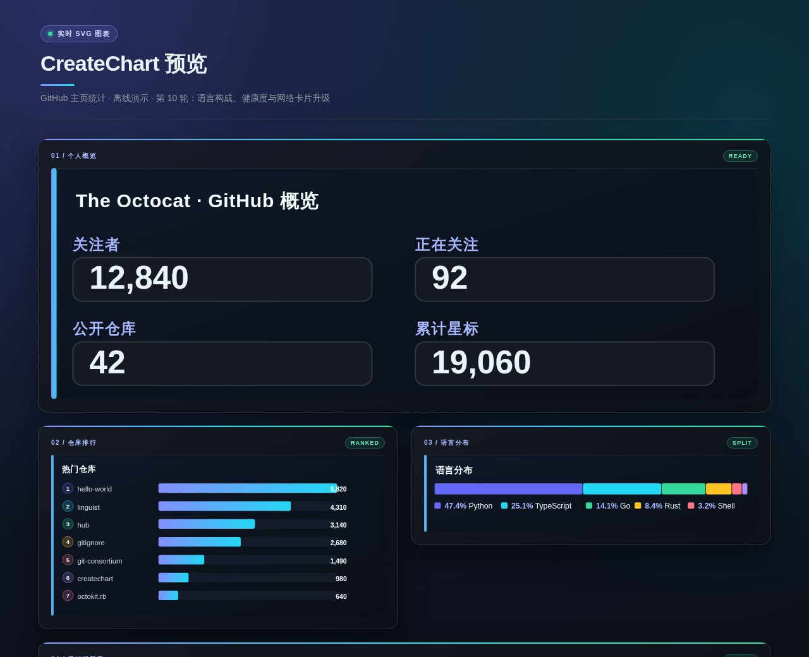

# CreateChart

Generate SVG statistical charts for GitHub profiles and repositories. Ready to drop into a GitHub Profile README.

## Features

- Profile overview card: followers, following, public repos, total stars
- Top repositories bar chart by stars/forks/any numeric repo field
- Language distribution stacked bar chart
- Advanced cards: contribution activity heatmap, project momentum radar, highlights, release timeline, cadence index, language mix, repository health, and collaboration network
- Pure SVG output — no JavaScript, works in any GitHub README
- Polished cards with contrast labels, rank badges, legend percentages, and value emphasis
- Offline demo mode for previewing charts without GitHub API calls
- Chinese and English labels via `--lang zh` / `--lang en`
- Refined typography, spacing, card hover states, status badges and title dividers
- Ten focused visual polish rounds with advanced insight cards, release/cadence views, language composition, repository health, collaboration network, and zh/en preview copy updates

## Install

```bash
pip install -e .
```

## Usage

```bash
export GITHUB_TOKEN=ghp_xxx  # optional but recommended for higher rate limits
createchart octocat -o charts
```

Generated files:

- `charts/profile.svg`
- `charts/repos.svg`
- `charts/languages.svg`
- `charts/activity.svg`
- `charts/momentum.svg`
- `charts/highlights.svg`
- `charts/releases.svg`
- `charts/cadence.svg`
- `charts/languages_mix.svg`
- `charts/health.svg`
- `charts/network.svg`

Embed in your profile README:

```markdown

```

Aggregate languages across up to 20 repos:

```bash
createchart octocat --repo-languages
```

## Preview

Run the offline demo to generate eleven sample charts and a standalone preview page:

```bash
createchart --demo --preview-html -o charts

# Chinese labels
createchart --demo --preview-html --lang zh -o charts-zh
```

Open `charts/preview.html` locally, or use this screenshot:



## Development

```bash
python -m pip install -e . pytest
pytest
```
